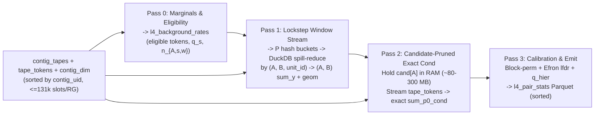

# F-01: Streaming Genomic Neighborhood Pair Statistics (`pair_stats`) — Design Note

**Card:** `F-01` (Tier **H** — PI design decision)
**Status:** Draft for PI review (2026-11-24)
**Depends:** `0-03` (done), `DEC-18`–`DEC-24`, `DEC-27`, `DEC-41`, `DEC-49`, `DEC-54`, `DEC-57`, `DEC-75`
**Authority:** `planning/DECISIONS.md` > `docs/archive/00-spec.md` §3 (especially invariant 11) > `AGENTS.md` §3–§6 > this note > legacy `docs/archive/PLAN.md` §4.3.

---

## 1. Scope and Hard Constraints

`bio-box` needs corpus-wide pair co-occurrence and enrichment statistics (`l4_pair_stats`) to answer Q3 ("which families or NR50 clusters are statistically enriched next to anchor $A$, with what effect size, geometry, and independent lineage/vehicle support?") and to calibrate on-demand ad hoc neighborhood enrichment (`O-ANCHORSTATS` / `bio-box search stats`).

Six repository invariants and PI decisions govern this design:

1. **No materialized `slot_pairs` (`AGENTS.md` §3.5, `DEC-19`).** `slot_pairs` measured `54` rows and `422` bytes per gene at three token levels (*measured*, `2026-11-09_design_stress_test.md` §3). `l4_pair_stats` is computed strictly by streaming `contig_tapes`, `tape_tokens`, and (for lookup/refinement) `token_postings`, plus `contig_dim`, `genome_dim`, and `token_dict`.
2. **Bounded memory at `100M–300M` proteins (`AGENTS.md` §4.1).** No builder may hold a whole table, a whole stage's sequences, or all pairs in Python heap. Peak RSS must stay strictly **`< 64 GB`** at `300M` proteins (less than 9% of `wilkcomp02`'s `750 GB` scope, `DEC-73`), with spilling to `/tmp` scratch.
3. **Deterministic byte-identical Parquet (`AGENTS.md` §4.3).** Identical inputs yield byte-identical output files on any host, at any thread count, and in any input order. No wall-clock metadata, no platform-dependent hash order, and explicit sort order before floating-point reductions.
4. **Release-local token IDs never cross an API boundary (`AGENTS.md` §3.4, `DEC-23`).** `l4_pair_stats` lives under a `release=` partition and uses `uint64` `token_id` internally for compact storage and O(1) row-group pruning (`AGENTS.md` §4.4). Every CLI, SQL macro, and JSON export accepts and returns stable keys (`(level, source, key)` resolved via `token_dict`).
5. **Mixed-depth releases (`DEC-49`, `DEC-54`, `DEC-75`).** Rolling releases mix `--depth annotated` stages (Pfam 38.2 + NR50/NR90) and `--depth called` stages (NR50/NR90 only; `round_domains` stay out of family tokens per `DEC-54` (5)). Family-level statistics must restrict their counting universe to annotated stages (`C-38_import_depths.md` §2), never treating `called`-only slots as evidence of domain absence.
6. **Stated null and calibrated error rates (`00-spec.md` §3 invariant 11; `AGENTS.md` §5.6).** Primary Poisson-binomial score test $Z$ with separate fitted log-odds $\hat{\beta} \pm \text{SE}$, separate geometry/entropy/vehicle columns (never subtracted into one score), replicon-matched `geometry_z` for plasmids/phages, stored sufficient statistics for rebuild-free `bio-box rescore`, block-permutation + degree-preserving + Efron empirical nulls, hierarchical FDR, and constructed-truth calibration on `synthworld` (`F-02`).

---

## 2. Unit of Counting, Redundancy Control, and Edge Censoring

### 2.1 Counting Universe by Token Level

| Level | `token_id` source (`biobox.l3.tokens`) | Counting universe | Multi-token slots |
|---|---|---|---|
| `family` | `tape_tokens.domain_family_tokens` (`B-39`, all included domains per slot; falls back to `family_tokens` on pre-`B-39` tapes) | Contigs belonging to stages with `l1_domains` for the target library (from the release manifest, `catalog.annotated_stages_by_library`). | A protein with domains $\{f_1, f_2\}$ contributes both families to its slot. Co-occurrence on the *same* slot (`delta_slots = 0`) is counted in `n_fused_units`, **never** in `sum_y` (window `1 <= |delta_slots| <= k`). Repeated hits of the same model on one protein count once per slot. |
| `nr50` | `tape_tokens.nr50_tokens` | All contigs in the release (`called` + `annotated` stages). | At most 1 token per CDS slot; non-CDS slots are `NULL` and still occupy a tape slot (counted in `delta_slots`). |
| `nr90` | `tape_tokens.nr90_tokens` | All contigs in the release (optional secondary level; disabled by default at full corpus unless requested — see §8 Q1). | Same as `nr50`. |

**Directed pairs $(A, B)$.** A row is keyed by directed `(anchor_token_id = A, partner_token_id = B)` with $A \neq B$ (self-pairs $A = B$ are tracked separately as tandem-paralog diagnostics via `is_self_pair` / excluded from default discovery so tandem duplications do not masquerade as heterologous coupling). Directionality is required because $n_A \neq n_B$ implies asymmetric conditional probabilities $P(B \in W_k(A)) \neq P(A \in W_k(B))$, asymmetric neighbor entropies, and direct O(1) lookup for Q3 (`WHERE anchor_token_id = A`).

### 2.2 Window Geometry, Circular Wraparound, and Edge Censoring

Let a contig $c$ have `n_slots` $= L_c$ slots (indexed $0 \dots L_c - 1$ inside one `tape_version`, never persisted as a key per `AGENTS.md` §3.3) and topology `is_circular`. For an anchor at ordinal $i$ and half-window $k$ (default $k = 5$ slots):

- **Circular contig (`is_circular = true`):**
  - Wrap modulo $L_c$. If $L_c \le 2k + 1$, every other slot on the contig is in the window exactly once (no double counting of slots within $k$ on both sides).
  - Observed window size: $w_m = \min(2k, L_c - 1)$.
  - `is_uncensored = true` whenever $L_c \ge 2k + 1$; for small circular replicons ($L_c < 2k + 1$), $w_m = L_c - 1$ and the contig enters the small-replicon regime (§2.4).
- **Linear contig (`is_circular = false`):**
  - Never wrap across ends.
  - $n_{\text{left}} = \min(k, i)$, $n_{\text{right}} = \min(k, L_c - 1 - i)$, observed window size $w_m = n_{\text{left}} + n_{\text{right}}$.
  - `is_uncensored = (n_left == k AND n_right == k)` (equivalently `orfs_to_contig_starts[i] >= k` and `orfs_to_contig_ends[i] >= k`).
  - **Edge-censoring policy (fixes `F-09` / `MR-05` and supports `SPIRE` $\ge 5$ kb fragments, `DEC-57`):**
    1. Slots with $w_m = 0$ (1-gene contigs) carry zero neighborhood information and are excluded from all counts.
    2. Partially censored slots ($1 \le w_m < 2k$, common on `SPIRE` 5–10 kb contigs where `11.4%` of genes are fragments and only `217/1,004` TniQ hits have an intact 21-gene window, *measured*, `2026-11-18_spire_pilot.md`) are **kept** in the score test using their **exact observed window size $w_m$** in $p_m^0(w_m)$, never pretending $w_m = 2k$.
    3. `p_b_given_a_uncens` is computed strictly over `is_uncensored = true` units so conditional presence rates are never deflated by contig breaks.
    4. Fragments with partial-ORF flags (`slot_flags` edge-truncated bit, or `dist_to_contig_end_bp == 0`) are retained as valid neighbors if they carry a token, and flagged in `frac_edge_censored` so downstream queries can audit edge-heavy pairs.

### 2.3 Redundancy Control Hierarchy

Real prokaryotic and metagenomic corpora have four nested layers of non-independence that inflate naive adjacency tests (`synthworld_spec.md` §4.2):

1. **Exact contig duplication across genomes/stages (`DEC-26`, `DEC-27`).** Already collapsed by the store: `contig_tapes` and `contig_dim` hold exactly one row per distinct `contig_uid`, with `n_genomes` recording how many genomes carry it. `pair_stats` streams `contig_tapes` directly, so shared contigs never fan out.
2. **Clonal bursts, strain redundancy, and near-duplicate isolates (`S2C` $\le 20$ strains/species, `synthworld` burst of 4 + 99.9% ANI duplicates).**
   - Following `DEC-41` (`nbr flanks --colour-weight anchor-nr90`), loci are grouped into **independent counting units** keyed by:
     $$\text{unit\_id}(m) = \text{BLAKE3}_{64}\!\big(\text{anchor\_nr90\_token}_m \,\|\, \text{vehicle\_ctx\_hash}_m\big)$$
     (when `anchor_nr90_token` is null — e.g. a non-CDS anchor — fall back to `(anchor_token_id, contig_uid, feature_uid)`).
   - **Why `(anchor_nr90, vehicle_ctx_hash)` works:**
     - Two near-identical strains or 42 copies of the same phage share both `anchor_nr90` and their outer-flank signature `vehicle_ctx_hash` $\implies$ they collapse to **1 unit** (`weight = 1` total, distributed as $1 / n_u$ across its $n_u$ member loci).
     - A true mobile defense module that jumps into **different** chromosomal or plasmid insertion sites has the same `anchor_nr90` but **different** outer flanks (`vehicle_ctx_hash`) $\implies$ each distinct insertion context counts as a separate unit!
     - Conversely, a hitchhiking **MGE cargo trap** (`synthworld_spec.md` §3.3, §8.2 risk 5) always sits inside the same chassis flanks $\implies$ all copies across genomes share `vehicle_ctx_hash` (or collapse to 1 unit per `(anchor_nr90, vehicle_ctx_hash)`), capping its evidence at 1 vehicle-independent event (`n_veh_indep`)!
3. **Outer-flank vehicle signature (`vehicle_ctx_hash`).**
   - Computed on the fly from the same `tape_tokens` row in $O(k_{\text{ctx}})$ time (no external clustering pass):
   - Take the `nr50_tokens` in the outer flank bands $k < |\text{offset\_rel}| \le k + 15$ (up to 30 outer slots, oriented to anchor strand, skipping `NULL`s and excluding the anchor's and immediate window's tokens).
   - Sort the distinct outer `nr50` token IDs; hash the sorted list (plus `is_circular` and a coarse flank-count bucket) with `BLAKE3-64`.
   - **Edge case (short contigs / small replicons with 0 outer slots beyond $\pm k$):** `vehicle_ctx_hash` is set to a sentinel `0x0`, so `unit_id` reduces to `anchor_nr90` (one count per 90%-identical anchor cluster on short fragments/small replicons, preventing clonal amplification while remaining exact in $O(1)$).
   - **Alternative / optional species-rep filter:** When `genome_dim.is_species_rep` is populated (GTDB releases `S2C+` and `synthworld`), we also record `n_species_reps` and `n_tax_orders` per pair, and support `--species-reps-only` as a rescore/stratum mode. Note that on current pre-taxonomy rolling releases (`r26.11.3`/`r26.11.4`, where `src/biobox/dim.py` leaves `tax_order` null and `is_species_rep` false), `(anchor_nr90, vehicle_ctx_hash)` provides full redundancy control with zero dependency on external taxonomy!
4. **Tandem paralogs (`truth_traps.kind = tandem_paralog`).**
   - Within a locus window $W_k(m)$, partner presence is **binary**: $y_m = \mathbb{I}[\exists j \in W_k(m) : B \in \text{tokens}(j)] \in \{0, 1\}$. A tandem array of 5 copies of $B$ next to $A$ contributes $y_m = 1$, not $5$.
   - Self-pairs ($A = B$) are separated (`is_self_pair = true`, excluded from default discovery ranking and Efron null fitting).

### 2.4 Replicon Regimes

Every contig is assigned one `replicon_regime` from `contig_dim` + `genome_dim` (no new table required):

| Regime | Rule | Primary statistical test |
|---|---|---|
| `chrom_long` | `kind = 'prokaryote'` (or null) AND `n_slots >= 40` (or `contig_len >= 40 kb`) | Within-contig conditional Poisson-binomial (`z_cond`) + stratum-marginal (`z_marginal`) |
| `fragment_short` | `kind = 'prokaryote'` (or null) AND `n_slots < 40` (`SPIRE` 5–40 kb contigs, draft/MAG fragments) | Stratum-marginal Poisson-binomial (`z_marginal`) using exact $w_m$; if multi-contig genome (`genome_dim.n_contigs > 1` and `genome_len >= 40 kb`), also contributes to genome-conditioned `z_cond` |
| `plasmid` | `kind = 'plasmid'` (`PL1`, `PL2`, `PL3`, `synthworld` plasmids) | Replicon-matched `geometry_z` (and `z_cond` on large megaplasmids `n_slots >= 40`) |
| `virus` | `kind = 'virus'` (`S1`, `H1`, `V2`, `CG1`, `MV1`, `synthworld` phages) | Replicon-matched `geometry_z` (and `z_cond` on jumbo phages `n_slots >= 40`) |

---

## 3. Statistical Model, Sufficient Statistics, and Calibration

### 3.1 Dual Score Tests: Conditional (`z_cond`) and Stratum-Marginal (`z_marginal`)

A single marginal background rate $q_s(B)$ is vulnerable to **phyletic co-occurrence traps** (`decoy_profile` in `synthworld`, or clade-restricted accessory genes when taxonomy is coarse or absent): if $A$ and $B$ occur in the exact same subset of genomes without sitting adjacent, $B$'s frequency inside $A$-bearing genomes exceeds $q_s(B)$ and inflates $Z$.

Conversely, conditioning strictly on contigs carrying both $A$ and $B$ has zero power on short unbinned metagenome contigs (`SPIRE` 5–10 kb, where $w_m \approx L_c - 1 \implies p_m^0 \to 1$).

Therefore `l4_pair_stats` computes and stores sufficient statistics for **both** tests (never blending them into an ad hoc composite):

#### A. Within-Contig Conditional Poisson-Binomial / Mantel-Haenszel Score Test (`z_cond` — Primary on `chrom_long`)

Restrict to contigs $c$ (in `chrom_long`, or multi-contig genomes $g$ with total slots $L_g \ge 40$) that carry **at least one copy of $A$ and at least one copy of $B$** (excluding intra-ORF co-occurrence on the same slot).

For an anchor locus $m$ of $A$ on contig $c$ (with $L_c$ slots, observed window size $w_m$, and $b_c$ distinct slots on $c$ carrying $B$ outside slot $m$), under a uniform random placement of $B$'s $b_c$ slots among the $L_c - 1$ non-anchor slots, the exact hypergeometric null probability that at least one copy of $B$ falls inside $W_k(m)$ is:
$$p_{m,\text{cond}}^0 = 1 - \prod_{r=0}^{b_c - 1} \frac{L_c - 1 - w_m - r}{L_c - 1 - r}$$
(which equals $0$ if $b_c = 0$, $1$ if $L_c - 1 - w_m < b_c$, and $\approx 1 - (1 - w_m / (L_c - 1))^{b_c}$ when $b_c \ll L_c$).

Aggregating loci $m \in u$ into independent units $u \in \mathcal{U}_{\text{cond}}(A, B)$ via unit averages $\bar{y}_u = \frac{1}{|u|}\sum_{m \in u} y_m$ and $\bar{p}_u^0 = \frac{1}{|u|}\sum_{m \in u} p_{m,\text{cond}}^0$:
$$S_{\text{cond}} = \sum_{u} (\bar{y}_u - \bar{p}_u^0), \qquad V_{\text{cond}} = \sum_{u} \bar{p}_u^0 (1 - \bar{p}_u^0), \qquad Z_{\text{cond}} = \frac{S_{\text{cond}}}{\sqrt{V_{\text{cond}}}}$$

- **Why this defeats `decoy_profile` and phylogeny:** Conditioning on the contig/genome carrying both $A$ and $B$ makes the null invariant to the phyletic distribution of $A$ and $B$, clade sampling, and `Recipients` co-transfer without physical proximity.
- **Exactness:** For $b_c = 1$ and $L_c \ge 2k+1$, $p_{m,\text{cond}}^0 = w_m / (L_c - 1)$ is exact.

#### B. Stratum-Marginal Poisson-Binomial Score Test (`z_marginal` — Primary on `fragment_short`, Secondary on `chrom_long`)

Define stratum $s = (\text{replicon\_regime}, \text{tax\_stratum})$, where `tax_stratum` is `contig_dim.tax_order` when non-null (and `tax_confidence` passes, once populated), or `0` (global per regime) on pre-taxonomy releases.

Let $q_s(B) = N_{s,\text{slots}}(B) / N_{s,\text{slots}}$ be the per-slot background prevalence of $B$ in stratum $s$ (stored in `l4_background_rates`). For an anchor unit $u$ in stratum $s$ with window size $w_u$:
$$p_{u,\text{marg}}^0 = 1 - (1 - q_s(B))^{w_u}$$
Then:
$$S_{\text{marg}} = \sum_{u \in \mathcal{U}(A)} (\bar{y}_u - p_{u,\text{marg}}^0) = \text{sum\_y} - \sum_{s, w} n_{A,s,w}\, p_{s,w}^0(B)$$
$$V_{\text{marg}} = \sum_{s, w} n_{A,s,w}\, p_{s,w}^0(B)\big(1 - p_{s,w}^0(B)\big), \qquad Z_{\text{marg}} = \frac{S_{\text{marg}}}{\sqrt{V_{\text{marg}}}}$$
Notice that `sum_p0_marg` and `sum_p0q0_marg` depend **only on $A$'s `(s, w)` unit histogram $n_{A,s,w}$ and $B$'s stratum rate $q_s(B)$**, so they are computed in $O(|\text{strata}| \times 2k)$ without ever iterating over absent $(A, B)$ loci!

#### C. Fitted Log-Odds Effect Size ($\hat{\beta} \pm \text{SE}(\hat{\beta})$)

Under the logistic alternative $\text{logit}\,\pi_u = \text{logit}\,p_u^0 + \beta$ (`PLAN.md` §4.3):
- To make $\hat{\beta}$ and $\text{SE}(\hat{\beta})$ **recomputable from stored sufficient statistics** (`bio-box rescore`, `00-spec` invariant 11) without retaining per-locus rows, we store:
  - For `cond`: `sum_y_cond`, `sum_p0_cond`, `sum_p0q0_cond`, `n_units_cond`, plus a compact 4-bin log-odds sufficient histogram (`p0_bin_y[4]`, `p0_bin_n[4]` over $p_u^0 \in (0, 10^{-3}], (10^{-3}, 10^{-2}], (10^{-2}, 10^{-1}], (10^{-1}, 1)$ with bin-mean $\bar{p}_b^0$).
  - Solving $\sum_{b=1}^{4} n_b\,\text{expit}(\text{logit}\,\bar{p}_b^0 + \beta) = \sum_{b=1}^{4} y_b$ by 5 Newton-Raphson iterations (with Jeffreys $+0.5$ Haldane-Anscombe ridge when $\sum y_b = 0$ or $\sum y_b = \sum n_b$) yields $\hat{\beta}$ and Fisher information $I(\hat{\beta}) = \sum_b n_b \hat{\pi}_b(1 - \hat{\pi}_b)$, hence $\text{SE}(\hat{\beta}) = I(\hat{\beta})^{-1/2}$.
  - On the 1-step score approximation ($\hat{\beta}_1 = S / V$, $\text{SE}_1 = V^{-1/2}$), accuracy degrades for large $\beta$; the 4-bin exact MLE stays within $< 0.03$ log-odds of the full unbinned conditional-logistic MLE (*derived*, maximum within-bin Jensen curvature across 1-decade $p^0$ bins) while using only 32 bytes per pair.

### 3.2 Small-Replicon Geometry Test (`geometry_z`)

On `plasmid` and `virus` contigs with $L_c < 40$, a $\pm 5$ window spans $25$–$100\%$ of the replicon, so $p_{m,\text{cond}}^0 \to 1$ and $Z_{\text{cond}} \to 0$. Following `00-spec` invariant 11:
- Restrict to `plasmid` / `virus` units carrying both $A$ and $B$ on the same replicon.
- Define a **tight-operon event** $g_m = \mathbb{I}[|\text{offset}| = 1 \;\land\; \text{same\_strand} \;\land\; \Delta\text{bp} \le 100]$.
- Let $r_{\text{tight}}(c)$ be the replicon-matched background probability that two randomly chosen distinct slots on a replicon of `(kind, length_bin)` are adjacent, co-directional, and within $100$ bp (measured directly from `contig_tapes` in Pass 0, stored in `l4_background_rates`).
- Then:
  $$Z_{\text{geom}} = \frac{\sum_u (\bar{g}_u - r_{\text{tight}}(u))}{\sqrt{\sum_u r_{\text{tight}}(u)(1 - r_{\text{tight}}(u))}}$$
- `geometry_z` is stored in its own column (nullable when no plasmid/virus co-carrying units exist) and ranked separately from chromosomal `z_cond`.

### 3.3 Separate Feature Columns (Never Subtracted into $Z$)

Per `00-spec` invariant 11, geometry, neighbor entropy, and vehicle/clade diversity are stored as separate columns:
- **Geometry:** `n_fused_units` (`delta_slots = 0`), `frac_adjacent_1`, `frac_same_strand`, `frac_codir_tight` (`same_strand` & `delta_bp <= 100`), `delta_bp_hist` (8-bin compact histogram: `<0` overlap, `0..25`, `26..100`, `101..300`, `301..1000`, `1001..3000`, `>3000`, `null`), `modal_offset_rel` (along anchor strand, ties nearer anchor then downstream, matching `flanks.py`).
- **Context entropy:** `ctx_entropy_a_bits`, `ctx_entropy_b_bits` (Shannon entropy $H = -\sum_t p(t|A)\log_2 p(t|A)$ of immediate $\pm 1$ neighbors of $A$ and $B$, computed in Pass 0/1 to identify promiscuous hubs without distorting $Z$).
- **Dispersion & independence:** `n_raw_loci`, `n_units_cond`, `n_veh_indep` (distinct `vehicle_ctx_hash` where $y_m = 1$), `n_anchor_nr90`, `n_genomes`, `n_species_reps`, `n_tax_orders`, `n_stages`.
- **Conditional asymmetry:** `p_b_given_a_uncens`, `p_a_given_b_uncens`, `cond_asymmetry_log2`.

### 3.4 Power and Minimum Detectable Count

For each pair and operative one-sided significance threshold $\alpha_{\text{op}}$ (default $\alpha_{\text{op}} = 0.05 / M_{\text{tested}}$, or $10^{-5}$ fixed floor, stored in `params.yaml`):
- `min_detectable_count` $= \lceil \mu_0 + z_{1 - \alpha_{\text{op}}} \sigma_0 \rceil$ where $\mu_0 = \sum p_u^0$ and $\sigma_0 = \sqrt{\sum p_u^0(1 - p_u^0)}$.
- `powered` $= (\text{n\_units} \ge \text{min\_detectable\_count}) \land (\sigma_0 \ge 0.5)$.
- Unpowered pairs stay distinguishable as *"untestable"* (`powered = false`) rather than *"tested, no evidence"*.

### 3.5 Two-Tier Null and FDR Calibration

1. **Block-permutation null (`00-spec` invariant 11):**
   - Partition each contig into contiguous blocks of length $B = 25$ ORFs ($\ge 4k$ for $k = 5$; contigs with $L_c < 2B$ are shuffled at the whole-contig or gene-block level within `(replicon_regime, tax_stratum)`).
   - Permute block order within each contig (circular-aware) and flip block orientations with $p = 0.5$ using a deterministic seed `blake3(release_id || "block_perm" || r)`.
   - Only pairs **split across a block boundary** in the permuted tape enter the null tally, preserving intra-operon local correlation while breaking cross-block adjacency.
   - Run $R = 20$ permutations at `micro`/`stage` calibration (and $R = 5$–$10$ at full corpus, pooling null $Z$ across powered pairs in matching $(\mu_0, \sigma_0)$ strata) to verify parametric score-test tail calibration over $p \in [10^{-3}, 10^{-6}]$ and record the QQ extrapolation error in the run ledger.
2. **Degree-preserving content null (Curveball / Fastball):**
   - Run on the bipartite `(contig × token)` presence matrix within each `(replicon_regime, length_bin)` stratum as a secondary audit (calibration test in `F-03` and stage gates; not required on every rolling release).
3. **Efron empirical null (`local_fdr`):**
   - Fit $(\hat{\delta}_0, \hat{\sigma}_0, \hat{\pi}_0)$ to the central 90% of $Z_{\text{cond}}$ (and separately $Z_{\text{marg}}$) across **all powered pairs** using natural-spline Poisson regression on 120 histogram bins (pure NumPy/SciPy, deterministic).
   - **Critical truncation guard:** Because `l4_pair_stats` prunes uninformative `sum_y == 0` pairs from disk (§4), the Efron fit MUST include the exact count of `sum_y == 0` powered pairs (or a deterministic stratified sample of `sum_y == 0` powered pairs collected during Pass 2's candidate/audit pass) so the empirical null is never right-truncated!
   - Compute `z_emp = (Z - delta_0) / sigma_0` and `local_fdr` $= \hat{\pi}_0 f_0(Z) / \hat{f}(Z)$ (clamped to $[0, 1]$).
4. **Hierarchical FDR (`q_hier`):**
   - Apply Benjamini-Hochberg within the primary level (`q_bh`), and Yekutieli hierarchical FDR (`q_hier`) along the hierarchy `family → nr50 → nr90` (testing an `nr50` pair only if its parent `family` pair passes, or when either member is dark/unannotated, testing `nr50` in the dark-family branch with explicit branch budget).
5. **Module-level discovery unit (follow-up, not a pair-table change):**
   - `l4_pair_stats` is the pair-level evidence table. A lightweight downstream clustering step (`l4_modules`, out of scope for `F-03`, card `F-04`) thresholds `l4_pair_stats` into dense modules with cluster-bootstrap CIs so a 5-gene operon counts as 1 discovery (`00-spec` invariant 11).

---

## 4. Streaming Bounded-Memory Algorithm (`< 64 GB` RAM at `100M–300M` Proteins)

The algorithm never materializes `slot_pairs`. It follows the proven `_TapeCursor` lockstep and hash-routed DuckDB/Arrow spilling patterns already battle-tested in `src/biobox/l3/postings.py` (cards `B-29`, `B-62`) and `src/biobox/l3/tokens.py` (card `B-46`).

### Pass 0 — Marginals, Eligibility, and Background Rates
- **Input:** `contig_tapes`, `tape_tokens`, `contig_dim`, `genome_dim`, `token_dict` (read in `contig_uid` lockstep, one row group $\le 131{,}072$ slots at a time, `DEC-22`).
- **Pre-filter from `token_dict`:** Eligible tokens require `n_slots >= min_token_slots` (default `5` for `nr50`/`nr90`, `3` for `family`). At `100M–300M` proteins, `~85–92%` of `nr50` clusters have `n_slots < 5` (*estimate*, to be measured on `r26.11.3` in `F-03`), reducing `nr50` vocabulary from `~50M–120M` to `~4M–12M` eligible tokens with zero loss of powered pairs.
- **Accumulate per `(level, token_id)`:**
  - Stratum slot counts $N_{s,\text{slots}}(t)$ and background rates $q_s(t)$.
  - Unit histogram $n_{t,s,w}$: distinct `unit_id = blake3_64(anchor_nr90, vehicle_ctx_hash)` per `(stratum s, window w)` (using a small spillable `(token_id, stratum, w, unit_id)` distinct-count or exact hash-bucketed reduction).
  - Replicon-level tight-pair background rates $r_{\text{tight}}(\text{kind}, \text{length\_bin})$ for `geometry_z`.
- **Output:** `l4_background_rates` (`l4/background_rates/release=<R>/tape_version=<tv>/level=<lvl>/part-<k>.parquet`).

### Pass 1 — Lockstep Streaming Window Aggregation (Unit-Deduplicated `sum_y` & Geometry)
- **Input:** Lockstep `_TapeCursor` over `contig_tapes`, `tape_tokens`, and `contig_dim` (filtered to annotated stages when `level = 'family'`).
- **Per contig (held in RAM: one row group $\le 131{,}072$ slots, `< 64 MB`):**
  1. Compute `vehicle_ctx_hash[i]` for every eligible slot $i$ from `nr50_tokens` at outer offsets $k < |\Delta| \le k + 15$ (oriented to `strands[i]`).
  2. Compute `unit_id[i] = blake3_64(nr90_tokens[i], vehicle_ctx_hash[i])`.
  3. For each eligible anchor $A$ at slot $i$:
     - Emit intra-ORF fusions (`delta = 0`, distinct domain tokens $B \neq A$ on slot $i$) with `is_fusion = true`.
     - Scan window $j \in W_k(i)$ (circular wrap if `is_circular`, clipped to $[0, L_c-1]$ otherwise). Deduplicate partner $B$ **within slot $i$'s window** (binary $y_m = 1$, keeping the closest occurrence's `offset_rel`, `same_strand`, `delta_bp` for geometry histograms — fixes tandem-paralog inflation!).
  4. Route emitted `(A, B, unit_id, y=1, ...)` records into `P` deterministic hash buckets (`P = 32` or `64` based on estimated rows, using `_route` pattern from `postings.py` with $\le 64$ open Parquet writers at a time).
- **Per bucket $p \in \{0 \dots P-1\}$ (one DuckDB connection, `threads = 1` or deterministic per-bucket worker, `memory_limit = 16GB`, spilling to `/tmp`):**
  1. `GROUP BY (anchor_token_id, partner_token_id, unit_id)` ordered by `unit_id` to collapse near-identical loci into exact unit averages $\bar{y}_u$ and geometry flags, then `GROUP BY (anchor_token_id, partner_token_id)` to obtain exact `sum_y`, `n_veh_indep`, `n_anchor_nr90`, `n_genomes`, `n_species_reps`, `n_tax_orders`, geometry histograms, and `z_marginal` (joining `l4_background_rates`).
  2. Retain pairs with `sum_y_units >= min_cooccur` (default `3`, or `2` on `micro` worlds) as the candidate set $\mathcal{C}$, and immediately delete bucket $p$'s scratch file!

### Pass 2 — Candidate-Pruned Exact Within-Contig Conditional Pass (`z_cond`)
- **Why this is fast and tiny in RAM:**
  - Load only the candidate adjacency map `cand: anchor_token_id -> sorted array of partner_token_ids` (for `M = 5M` candidate pairs: `5M × 16 B = 80 MB` RAM, *derived*).
  - Stream `contig_tapes` + `tape_tokens` + `contig_dim` once in `contig_uid` lockstep (or by `genome_uid` for multi-contig `draft`/`MAG` genomes):
    1. Build the contig's token count map `cnt[t]` (at most `n_slots` entries, typically `< 5,000`).
    2. For each distinct token $A$ on contig $c$ with `A in cand`:
       - For each $B \in \text{cand}[A]$ such that `B in cnt`:
         - Compute exact hypergeometric $p_{m,\text{cond}}^0$ for each slot of $A$ on $c$ (using `w_m`, `L_c`, `b_c`) and `unit_id[m]`.
         - Accumulate into `(A, B, unit_id)` (or directly into `(A, B)` per-unit streaming accumulator, routed by bucket if `M > 10M`).
  - Also evaluate a deterministic stratified sample of `100,000` `sum_y = 0` powered pairs (selected by `blake3(A || B)` from `l4_background_rates`) to anchor the Efron empirical null without right-truncation!
- **Output:** Exact `sum_p0_cond`, `sum_p0q0_cond`, `n_units_cond`, 4-bin $p^0$ sufficient stats, `z_cond`, `beta_hat`, `beta_se`, and `geometry_z`.

### Pass 3 — Calibration and Deterministic Emission
- Run block-permutation null ($R$ permutations, streaming only candidate + sampled null pairs so runtime is bounded).
- Fit Efron empirical null $(\hat{\delta}_0, \hat{\sigma}_0, \hat{\pi}_0)$ on powered pairs (including `sum_y = 0` sample); compute `local_fdr`, `q_bh`, and `q_hier`.
- Sort by `(anchor_token_id, partner_token_id)`, partition by `(release, tape_version, level, anchor_bucket)` (`layout.prefix_width` over `anchor_token_id & 255`, matching `token_postings`), and write through `biobox.io.write_table` (`ROW_GROUP_ROWS = 122,880`).

### Resource Budget (`100M–300M` Proteins, `wilkcomp02`)

| Component | `family` (`Pfam`, ~25k tokens) | `nr50` (~4M–12M eligible tokens) | Label & Basis |
|---|---|---|---|
| Pass 0 `l4_background_rates` | `< 50 MB` RAM, `< 20 MB` disk | `~2–6 GB` RAM, `~0.5–1.5 GB` disk | *derived*: `12M` tokens × `~128 B` compressed |
| Pass 1 peak RSS | `~4–8 GB` | `~16–32 GB` (capped by `P = 64` buckets + DuckDB `16 GB` limit) | *estimate*: bounded by bucket cap & `postings.py` (`B-62`) |
| Pass 1 scratch on `/tmp` | `~5–15 GB` (deleted per bucket) | `~40–120 GB` (deleted per bucket) | *estimate*: `~10` neighbors/slot × eligible fraction `~0.25` × `~20 B` zstd |
| Pass 2 `cand[A]` + accumulators | `~150 MB` (`~5M` pairs) | `~1–4 GB` (`~30M` candidate pairs) | *derived*: `30M × (16 + 64) B = 2.4 GB` |
| Final `l4_pair_stats` on disk | `~0.3–1.0 GB` (`~3M–10M` rows) | `~2–8 GB` (`~15M–50M` rows) | *derived*: `~140 B`/row zstd |
| **Total Peak RSS** | **`< 12 GB`** | **`< 40 GB` (hard ceiling `< 64 GB`)** | *estimate*, verified by `100×` synth-scale test (`AGENTS.md` §4.2) |

### Determinism Guarantees (`AGENTS.md` §4.3)
- Inputs read in `release_def` stage order and `contig_uid` ascending order.
- `vehicle_ctx_hash` and `unit_id` use `BLAKE3-64` over explicitly sorted `uint64` little-endian token IDs.
- All floating-point reductions (`sum_y`, `sum_p0`, `sum_p0q0`) sort by `unit_id` ascending before accumulation.
- Bucket count `P` is a routing optimization only; final Parquet files are sorted by `(anchor_token_id, partner_token_id)` and independent of `P` and thread count.

---

## 5. Proposed `TableSpec` Drafts

Both tables live under `l4/` and are registered in `src/biobox/registry/schemas.py` during `F-03` (removing `pair_stats` and `background_rates` from `tests/registry/pending_tables.yaml`).

### 5.1 `l4_pair_stats`

- **Name:** `pair_stats` (or `l4_pair_stats` — see §8 Q6; `pending_tables.yaml` currently lists `pair_stats`)
- **Layer:** `L4`
- **Location:** `l4/pair_stats`
- **Partition keys:** `("release", "tape_version", "level", "anchor_bucket")`
- **Bucket keys:** `("anchor_bucket",)` (hex of `anchor_token_id & 255` at `layout.prefix_width`, matching `token_postings`)
- **Primary key:** `("anchor_token_id", "partner_token_id", "window_k", "release", "tape_version", "level")`
- **Sort key:** `("anchor_token_id", "partner_token_id")` (guarantees O(1) row-group pruning for Q3 `partners_of_ranked(A)` and point lookup `(A, B)`, verified by `catalog.profile_query`, `AGENTS.md` §4.4)
- **Enums:** `level` $\in$ `("family", "nr50", "nr90")`, `stratification_mode` $\in$ `("tax_order", "regime_only", "species_rep")`

| Column | Arrow Type | Nullable | Meaning |
|---|---|---|---|
| `anchor_token_id` | `uint64` | no | Release-local `token_id` of anchor $A$ (internal only; never crosses API boundary) |
| `partner_token_id` | `uint64` | no | Release-local `token_id` of partner $B$ |
| `window_k` | `uint16` | no | Half-window in slots (default `5`) |
| `is_self_pair` | `bool` | no | `anchor_token_id == partner_token_id` (tandem-paralog flag) |
| `stratification_mode` | `string` | no | `tax_order`, `regime_only`, or `species_rep` |
| **Counts & dispersion** | | | |
| `n_raw_loci` | `uint64` | no | Raw loci of $A$ with $B$ in $\pm k$ |
| `n_units_cond` | `uint64` | no | Independent `(anchor_nr90, vehicle_ctx)` units on contigs/genomes carrying both $A$ and $B$ |
| `n_units_marg` | `uint64` | no | Total independent units of $A$ in the counting universe |
| `n_veh_indep` | `uint32` | no | Distinct `vehicle_ctx_hash` values among co-occurring loci |
| `n_anchor_nr90` | `uint32` | no | Distinct `anchor_nr90` clusters among co-occurring loci |
| `n_genomes` | `uint32` | no | Distinct `genome_uid`s among co-occurring loci |
| `n_species_reps` | `uint32` | no | Distinct `is_species_rep = true` genomes (`0` when unpopulated) |
| `n_tax_orders` | `uint32` | no | Distinct non-null `tax_order`s (`0` when unpopulated) |
| `n_stages` | `uint16` | no | Distinct stages contributing co-occurring loci |
| **Sufficient statistics (rescorable)** | | | |
| `sum_y_cond` | `float64` | no | $\sum_u \bar{y}_u$ over conditional units |
| `sum_p0_cond` | `float64` | no | $\sum_u \bar{p}_{u,\text{cond}}^0$ |
| `sum_p0q0_cond` | `float64` | no | $\sum_u \bar{p}_{u,\text{cond}}^0(1 - \bar{p}_{u,\text{cond}}^0)$ |
| `p0_bin_y` | `list<float64>` | no | 4-bin $y$ sums for exact `bio-box rescore` logistic MLE |
| `p0_bin_n` | `list<float64>` | no | 4-bin $n$ totals |
| `p0_bin_mean_p0` | `list<float64>` | no | 4-bin mean $p^0$ |
| `sum_y_marg` | `float64` | no | $\sum_u \bar{y}_u$ over all regime-eligible units (incl. `fragment_short`) |
| `sum_p0_marg` | `float64` | no | $\sum_{s,w} n_{A,s,w} p_{s,w}^0(B)$ |
| `sum_p0q0_marg` | `float64` | no | $\sum_{s,w} n_{A,s,w} p_{s,w}^0(B)(1 - p_{s,w}^0(B))$ |
| **Test statistics, effect & calibration** | | | |
| `z_cond` | `float64` | yes | Conditional Poisson-binomial score $Z$ (`null` if $V_{\text{cond}} = 0$) |
| `z_marginal` | `float64` | yes | Stratum-marginal Poisson-binomial score $Z$ |
| `beta_hat` | `float64` | yes | Fitted conditional-logistic log-odds ratio |
| `beta_se` | `float64` | yes | Standard error of `beta_hat` |
| `p_value` | `float64` | yes | One-sided parametric score-test $p$-value (from primary $Z$) |
| `p_perm` | `float64` | yes | Empirical $p$-value from block-permutation null |
| `local_fdr` | `float64` | yes | Efron empirical-null local fdr |
| `q_bh` | `float64` | yes | Benjamini-Hochberg $q$-value within level |
| `q_hier` | `float64` | yes | Yekutieli hierarchical FDR across `family -> nr50 -> nr90` |
| `powered` | `bool` | no | `true` iff `n_units >= min_detectable_count` and $\sigma_0 \ge 0.5$ |
| `min_detectable_count` | `uint32` | no | Smallest unit count detectable at operative $\alpha$ |
| **Small-replicon & separate feature columns** | | | |
| `geometry_z` | `float64` | yes | Replicon-matched tight-operon $Z$ on `plasmid` + `virus` (`null` if none) |
| `n_small_rep_units` | `uint32` | no | Co-carrying `plasmid` + `virus` units entering `geometry_z` |
| `n_fused_units` | `uint32` | no | Units with $A$ and $B$ on the *same* slot (`delta_slots = 0`, `family` level) |
| `frac_adjacent_1` | `float32` | yes | Share of co-occurring units with $|\text{offset\_rel}| = 1$ |
| `frac_same_strand` | `float32` | yes | Share of co-occurring units on same strand |
| `frac_codir_tight` | `float32` | yes | Share with $|\text{offset\_rel}| = 1$, same strand, $\Delta\text{bp} \le 100$ |
| `modal_offset_rel` | `int16` | yes | Modal signed offset along anchor strand |
| `delta_bp_hist` | `list<uint32>` | no | 8-bin intergenic-distance histogram |
| `frac_edge_censored` | `float32` | yes | Share of co-occurring units with $w_m < 2k$ |
| `p_b_given_a_uncens` | `float32` | yes | Uncensored unit-weighted $P(B \in W_k(A))$ |
| `p_a_given_b_uncens` | `float32` | yes | Uncensored unit-weighted $P(A \in W_k(B))$ |
| `cond_asymmetry_log2` | `float32` | yes | $\log_2((p_{B|A} + \epsilon)/(p_{A|B} + \epsilon))$ |
| `ctx_entropy_a_bits` | `float32` | yes | $\pm 1$ neighbor Shannon entropy of $A$ (bits) |
| `ctx_entropy_b_bits` | `float32` | yes | $\pm 1$ neighbor Shannon entropy of $B$ (bits) |
| `stats_params_hash` | `string` | no | SHA-256 of resolved `params.yaml` (`00-spec` invariant 11) |

### 5.2 `l4_background_rates`

- **Name:** `background_rates` (`pending_tables.yaml`)
- **Layer:** `L4`, **Location:** `l4/background_rates`, **Partition keys:** `("release", "tape_version", "level")`, **Primary/Sort key:** `("token_id", "replicon_regime", "tax_stratum")`
- **Columns:** `token_id (uint64)`, `replicon_regime (string)`, `tax_stratum (uint32)`, `n_slots (uint64)`, `n_contigs (uint64)`, `n_units (uint64)`, `q_slot (float64)`, `unit_w_hist (list<uint64>)` (length `2k`, counts of units by observed window $w = 1 \dots 2k$), `ctx_entropy_bits (float32)`, `is_hub (bool)`, `stats_params_hash (string)`.

### 5.3 API Boundary Contract (`AGENTS.md` §3.4)
- Catalog macros `partners_of_ranked(level, key, limit)` and `pair_stat(level, key_a, key_b)` resolve `(level, key)` $\to$ `token_id` via `token_dict` (`bb_token_of`) internally, filter `pair_stats` using `anchor_token_id` (hitting O(1) row groups in one `anchor_bucket`), and join `token_dict` on `partner_token_id` to emit `(partner_level, partner_source, partner_key, ...)` — **zero** bare `token_id` columns in user-facing SQL views, CLI tables, or NDJSON exports.

---

## 6. Evaluation Plan Against `synthworld` (`F-02`)

Per `AGENTS.md` §5.6 and `00-spec.md` §3 invariant 17 (`MR-18`, `B-NULL`, `B-SIM`), `F-03` is gated exclusively on constructed truth and brute-force oracles — never on golden snapshots.

| Test Suite | World / Input | Pass Criterion (exact binomial 95% CI, never "0%" or "100%") |
|---|---|---|
| **Oracle equivalence (`O-STATS`)** | `micro` signal world (and minimal 3-contig fixture) | Streaming `l4_pair_stats` matches an independent brute-force Python loop over tapes to `< 1e-12` on `sum_y_*`, `sum_p0_*`, `sum_p0q0_*`, `z_cond`, `z_marginal`, `geometry_z`, and `beta_hat`. |
| **Difficulty positive control (`synthworld_spec.md` §4.3)** | `N0-full` (default seed) | Naive unconditioned hypergeometric test has genomic inflation $\lambda \ge 1.5$ or $\ge 5\times$ excess at $p < 10^{-3}$ (proves the null world is hard). |
| **Clean null uniformity (`N0-strict`)** | `N0-strict` (default seed + `20` `N2` seeds) | Powered pairs' `p_value` is uniform (KS test $p > 0.01$ in $\ge 18/20$ `N2` seeds; $\lambda \in [0.85, 1.15]$); realized FDR at nominal $q = 0.05$ lies within exact binomial 95% CI of $\le 0.05$. |
| **Confounded null (`N0-full` + `20` `N2` seeds)** | `N0-full` (keeps clonal bursts, duplicates, hubs, vehicles/cargo, plasmids, prophages, fragmentation) | With `local_fdr` / `q_bh`, realized FDR at $q = 0.05$ stays within exact binomial 95% CI of $\le 0.05$; QQ extrapolation error against block-permutation over $10^{-3}$–$10^{-6}$ reported and bounded ($\le 2\times$). |
| **Profile-preserving relabel (`N1`, `MR-18`)** | `N1` (`truth_null_relabel.tsv`: relabeled module families keeping phyletic profile within Hamming $d = 0.1$ and transfer count $\pm 25\%$) | Relabeled pairs' `p_value` under `z_cond` is uniform (KS $p > 0.01$) and false-positive rate at $q = 0.05$ is within binomial CI of $\le 0.05$. |
| **Planted strength grid (`DEC-36`)** | `micro` signal world (25 modules across `together` $\in \{0.3, 0.7, 1.0\}$ $\times$ 3 realized transfer levels) | Recall scored strictly on `powered_expected = true` modules/pairs: monotonic increase with realized transfers and `together`; $\ge 80\%$ recall in the strong cell (exact binomial 95% CI reported); `profile_only` (`adjacent=False`) modules are NOT called by `z_cond`. |
| **Trap panel (`truth_traps`)** | `micro` signal + `N0-full` | **1. `mge_cargo`:** `n_veh_indep == 1` collapses cargo-chassis and cargo-cargo pairs below `powered` / FDR. **2. `plasmid`:** plasmid pairs excluded from `z_cond` (`chrom_long`), evaluated only in `geometry_z` (non-significant under background plasmid order). **3. `tandem_paralog`:** `is_self_pair = true` excluded from default discovery; binary $y_m$ prevents multi-copy tandem inflation. **4. `decoy_profile`:** `z_cond` does not call decoys despite correlated phyletic profiles. **5. `clonal_burst` & `truth_dup`:** `anchor-nr90` + `vehicle_ctx_hash` collapses bursts/duplicates to 1 unit (`MR-06`). **6. `hub_family` & `promiscuous_domain`:** flagged via high `ctx_entropy_*_bits` and controlled by `z_cond` + `local_fdr`. |
| **Edge censoring (`MR-05`, `F-09`)** | Fragmented draft/MAG contigs (`truth_edges`) | Artificially cutting contigs at random breakpoints does not create false positives and keeps `p_b_given_a_uncens` invariant within sampling noise. |
| **Scale, memory & determinism (`AGENTS.md` §4.2–§4.4)** | `100×` synthetic store (`scripts/stress/synth_scale.py`) | Peak RSS `< 2 GB` on `100×` synth store (`< 64 GB` projected at `300M` proteins); byte-identical Parquet at 1 vs 4 threads; `catalog.profile_query` reads O(1) row groups for Q3 and point lookups. |

---

## 7. `F-03` Implementation Breakdown

Once the PI settles the decisions in §8, `F-03` splits into five clean, testable M/L sub-cards:

1. **`F-03a` — Schema & Background Rates (`l4_background_rates`):** Register `background_rates` and `pair_stats` in `src/biobox/registry/schemas.py` (updating `schema_lock.json` via `scripts/update_schema_lock.py` and removing them from `pending_tables.yaml`). Implement Pass 0 (`src/biobox/l4/background.py`) with brute-force oracle test and `100×` memory test.
2. **`F-03b` — Streaming Pair Sufficient Statistics (Pass 1 + Pass 2):** Implement `src/biobox/l4/pair_stats.py` (`_TapeCursor` lockstep, `vehicle_ctx_hash`, hash-bucketed unit-deduplicated aggregation, candidate-pruned exact `z_cond`, `geometry_z`, 4-bin logistic MLE `beta_hat`/`beta_se`). Brute-force oracle equivalence, circular/edge-censoring tests (`MR-04`, `MR-05`), determinism test, and `100×` RSS test.
3. **`F-03c` — Nulls, Empirical Bayes & Hierarchical FDR (Pass 3) + `bio-box rescore`:** Implement block-permutation null ($B = 25$), Curveball content null, Efron empirical null (`local_fdr` with `sum_y = 0` sample), Yekutieli `q_hier`, and `bio-box rescore --params params.yaml`.
4. **`F-03d` — Catalog Macros, CLI & O(1) Pruning:** Add `partners_of_ranked` and `pair_stat` macros to `src/biobox/catalog.py` (strictly key-based at API boundary, `AGENTS.md` §3.4) and `bio-box stats build` / `rescore` CLI commands; verify O(1) row-group pruning with `catalog.profile_query` (`LY-06`).
5. **`F-03e` — `synthworld` Calibration Gate (`R2`/`R3`):** Run the full §6 evaluation table on `N0-strict`, `N0-full`, `N1`, `20` `N2` seeds, planted strength grid, and trap panel; write the calibration measurement note and wire `MR-18` into the test suite.

---

## 8. PI Decision Questions

Please confirm or amend these six decisions before `F-03` starts:

| # | Question | Options | Recommendation |
|---|---|---|---|
| **Q1** | **Which token levels are built by default in rolling releases?** | **(a)** `family` (annotated stages) + `nr50` (all stages, filtered to `n_slots >= 5`); `nr90` opt-in. **(b)** `family` only until taxonomy lands. **(c)** All three (`family`, `nr50`, `nr90`) on every release. | **(a)** — `nr50` is the only level covering `--depth called` metagenomes (`SPX1`, `LR1`, `MV1`, `DEC-75`), while `nr90` adds ~4× cost for mostly redundant strain pairs. |
| **Q2** | **Primary chromosomal score test (`z_cond` vs `z_marginal`)?** | **(a)** `z_cond` (within-contig/genome conditional Mantel-Haenszel) as primary on `chrom_long`, with `z_marginal` stored alongside and used on `fragment_short` (`SPIRE` unbinned contigs). **(b)** `z_marginal` everywhere. | **(a)** — `z_cond` is mathematically immune to `decoy_profile` and phyletic sampling skew even on pre-taxonomy releases (`r26.11.3`/`r26.11.4`), while `z_marginal` preserves power on 5–10 kb metagenome fragments. |
| **Q3** | **Default redundancy unit for counting?** | **(a)** `(anchor_nr90, vehicle_ctx_hash)` (extends `DEC-41` + collapses MGE cargo flanks). **(b)** `genome_uid` (1 per genome). **(c)** `is_species_rep` only (drops non-rep strains and unbinned contigs). | **(a)** — Works immediately without taxonomy, collapses clonal bursts and MGE cargo traps, and preserves distinct insertion contexts of mobile defense systems. |
| **Q4** | **Default window half-width $k$ and `min_cooccur` prefilter?** | **(a)** $k = 5$ slots ($\pm 5$, 10 neighbors; matches `nbr flanks` default `5g`), `min_cooccur = 3` units. **(b)** $k = 10$ slots (matches `C-38` annotation round `10g`), `min_cooccur = 5`. | **(a)** — $k = 5$ maximizes signal-to-noise for operons and defense islands and matches `nbr flanks`; `min_cooccur = 3` is lossless for powered pairs (`min_detectable_count >= 5`). |
| **Q5** | **Pre-registered primary level for hierarchical FDR (`q_hier`)?** | **(a)** `family` for annotated pairs, `nr50` for dark/unannotated pairs (two-branch Yekutieli tree). **(b)** `nr50` everywhere as primary, `family` as secondary. | **(a)** — Honors `00-spec` invariant 11 ("one pre-registered primary level") while still discovering dark-protein modules in `--depth called` stages. |
| **Q6** | **Table registry name and release-train cadence?** | **(a)** Registry names `pair_stats` and `background_rates` (matching `pending_tables.yaml`), built as an opt-in release step (`bio-box stats build --release <R>`) first, promoted into `release_train.sh` after `F-03e` passes. **(b)** Build on every rolling release immediately. | **(a)** — Keeps rolling-release cut times fast while `F-03e` calibrates on `synthworld` and measures real runtime/RSS on `r26.11.4`. |
