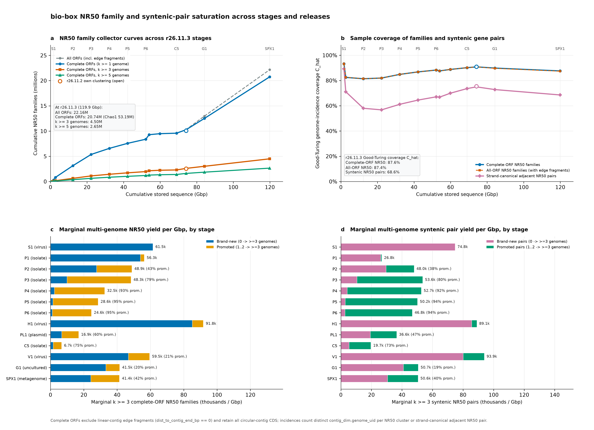

# Release-level protein-family and syntenic-pair saturation tracker (card A-33, DEC-86 (1))

- **Date:** 2026-11-27. Branch `task/A-33`. Host for every *measured* number in this note: `wilkcomp02`.
- **Files:** `scripts/stress/build_stage_pod/release_saturation.py` (`measure`, `history`, `render`),
  `scripts/stress/build_stage_pod/train_check.py` (`--saturation-summary`),
  `scripts/stress/build_stage_pod/release_train.sh` (step 8 wiring), `RUNBOOK.md`,
  `tests/r1/test_a33_release_saturation.py`, `planning/measurements/release_saturation_history.json`, and
  `planning/measurements/2026-11-27_release_saturation/release_saturation.{png,svg}`.
- **Number labels (`AGENTS.md` §6):** Every number below carries its explicit label: *measured* (`host`, `date`,
  `command`), *derived* (`formula` and inputs), or *estimate*.

## 1. Reproducing the measurements and figure

All commands run read-only on `wilkcomp02` inside the pinned images (`<= 4` threads, `MemoryMax=16G`, `MemorySwapMax=0`,
`nice -n 19`, `/tmp/if2453/r10/root` bound `:ro`):

```sh
# 1. Measure r26.11.2 (against earlier manifest r26.11.1) and r26.11.3 (against r26.11.2)
systemd-run --user --unit=a33-meas-r2-v2 --wait --collect -p MemoryMax=16G -p MemorySwapMax=0 -p CPUQuota=400% \
  /usr/bin/nice -n 19 /usr/bin/singularity exec --cleanenv --env OMP_NUM_THREADS=4 --env PYTHONPATH=$TREE/src \
  --bind /sys/fs/cgroup:/sys/fs/cgroup:ro --bind /tmp/if2453/r10/root:/tmp/if2453/r10/root:ro \
  --bind /tmp/if2453/a33:/tmp/if2453/a33 --bind $TREE:$TREE:ro \
  /stor/home/if2453/bio-box/images/bio-box_faec1f4.sif \
  python $TREE/scripts/stress/build_stage_pod/release_saturation.py measure \
    --root /tmp/if2453/r10/root --release r26.11.2 --earlier r26.11.1 \
    --threads 4 --tmp /tmp/if2453/a33/tmp --out /tmp/if2453/a33/r2 --stats-out /tmp/if2453/a33/r2/stats.json

systemd-run --user --unit=a33-meas-r3 --wait --collect -p MemoryMax=16G -p MemorySwapMax=0 -p CPUQuota=400% \
  /usr/bin/nice -n 19 /usr/bin/singularity exec --cleanenv --env OMP_NUM_THREADS=4 --env PYTHONPATH=$TREE/src \
  --bind /sys/fs/cgroup:/sys/fs/cgroup:ro --bind /tmp/if2453/r10/root:/tmp/if2453/r10/root:ro \
  --bind /tmp/if2453/a33:/tmp/if2453/a33 --bind $TREE:$TREE:ro \
  /stor/home/if2453/bio-box/images/bio-box_faec1f4.sif \
  python $TREE/scripts/stress/build_stage_pod/release_saturation.py measure \
    --root /tmp/if2453/r10/root --release r26.11.3 --earlier r26.11.2 \
    --threads 4 --tmp /tmp/if2453/a33/tmp --out /tmp/if2453/a33/r3 --stats-out /tmp/if2453/a33/r3/stats.json

# 2. Verify history JSON labels/formulas and render figure (1 thread in test image)
systemd-run --user --scope --quiet -p MemoryMax=4G -p MemorySwapMax=0 -p CPUQuota=100% \
  /usr/bin/nice -n 19 /usr/bin/singularity exec --cleanenv --env OMP_NUM_THREADS=1 --env PYTHONPATH=$TREE/src \
  --bind $TREE:$TREE /stor/home/if2453/bio-box/images/bio-box-test_faec1f4.sif \
  python $TREE/scripts/stress/build_stage_pod/release_saturation.py render \
    --data $TREE/planning/measurements/release_saturation_history.json \
    --out $TREE/planning/measurements/2026-11-27_release_saturation/release_saturation
```

## 2. Definitions and bounded-memory streaming architecture (`DEC-86 (1)`)

1. **Manifest-only inputs (`AGENTS.md` §3.9):** `release_saturation.py measure` reads only the explicit file entries in
   `manifests/release=<REL>.json` (`contig_index`, `protein_occurrence`, `member_cluster`, `contig_dim`, `contig_tapes`,
   `tape_tokens`, and `tape_version_def` if needed to disambiguate `gene_call_version`). It never globs directories,
   refuses `--tmp` or `--out` inside `--root`, and fails cleanly if `archived/release=<REL>.json` exists.
2. **Complete ORFs vs linear-contig edge fragments:** A `protein_occurrence` row is counted as a complete ORF iff
   `dist_to_contig_end_bp > 0`. On linear contigs, CDS features truncated at `start == 0` or `end == contig_len` have
   `dist_to_contig_end_bp == 0` (`src/biobox/l1/genecall.py`) and are excluded from `complete_orf` while retained in
   `all_orf`. On circular contigs (`is_circular == true`), `dist_to_contig_end_bp == contig_len > 0` for all CDS
   features including origin-crossing genes (`end > contig_len`), so every circular-contig CDS is included.
3. **Distinct genome incidences (`g_c`):** Every occurrence is mapped through `contig_dim` (`contig_uid -> genome_uid`).
   Multiple identical or homologous ORFs within the same `genome_uid` (across multiple loci, contigs, or stages) count
   as at most `1` genome incidence per NR50 cluster (`g_c >= 1` distinct `genome_uid` values). Let `f_k` be the number
   of clusters with `g_c == k`, `S_obs = sum_{k>=1} f_k`, and `N_inc = sum_c g_c`:
   - Good-Turing genome-incidence sample coverage: `C_hat = 1 - f1 / N_inc` (`1.0` when `N_inc == 0`; *derived*).
   - Bias-corrected Chao1 asymptotic richness: `Chao1 = S_obs + f1 * (f1 - 1) / (2 * (f2 + 1))` (*derived*).
4. **Actionable multi-genome family yield (`k >= 3`, `k >= 5`):** For each stage `m` in `man["stages"]` order (and for
   the batch of stages added since `--earlier`), net new `k >= K` complete-ORF NR50 clusters are decomposed into
   `brand_new_ge_K` (`0` genomes in the earlier prefix -> `>= K` genomes) plus `promoted_to_ge_K` (`1..K-1` genomes in
   the earlier prefix -> `>= K` genomes).
5. **Strand-canonical adjacent CDS NR50 pairs:** From `contig_tapes` (`is_circular`, `n_slots`, `strands`) and
   `tape_tokens` (`nr50_tokens`), adjacent slot pairs `(i, i + 1)` for `0 <= i < n_slots - 1` plus circular wraparound
   `(n_slots - 1, 0)` iff `is_circular` and `n_slots >= 2` are formed, skipping any pair where either slot has a null
   `nr50_tokens` entry (non-CDS slots such as ncRNA or CRISPR). Each pair `((t_a, s_a), (t_b, s_b))` is canonicalized
   against its reverse-complement `((t_b, -s_b), (t_a, -s_a))` by taking `min(fwd, rev)` and deduplicated to distinct
   `contig_dim.genome_uid` incidences.
6. **Co-sorted streaming + disk-bucket reduction (no unpartitioned hash joins):** Following the memory warning in
   `src/biobox/l3/tokens.py`, `release_saturation.py` never runs a multi-100M-row DuckDB hash join. Instead:
   - `contig_dim` (`3,110,913` distinct genomes across `4,338,167` contigs on `r26.11.3`, *measured*) is written once as
     a `99.3 MiB` (*derived*: `4,338,167 * (16 + 8 + 8 + 4) / 2^20`) read-only `np.memmap` sorted by `contig_uid`.
   - `member_cluster` (`WHERE level = 'nr50'`, sorted by `(level, member_uid)`) and per-stage `protein_occurrence`
     (sorted by `protein_uid`) are partitioned across `<= 4` `spawn` worker processes by `member_uid` row-group slices
     with Parquet footer `min`/`max` row-group pruning, scattering `24`-byte `(cluster_hi, cluster_lo, packed_meta)`
     records into `B` (`32` on `r26.11.2`, `64` on `r26.11.3`, *measured*) temporary files under `--tmp`.
   - `tape_tokens` and per-stage `contig_tapes` (both sorted by `contig_uid`) are co-streamed across `<= 4` workers by
     `contig_uid` row-group slices into `B` pair buckets (`24` bytes per emitted pair occurrence) and reduced one
     bucket per worker via 64-bit integer introsort (`_sort_3u64_fast`).

## 3. Runtime and memory on `wilkcomp02`

All runs executed on `wilkcomp02` on 2026-11-27 inside `bio-box_faec1f4.sif` (`sha256:d67300aa1321...`) with
`MemoryMax=16G`, `MemorySwapMax=0`, `CPUQuota=400%`, `nice -n 19`, `--threads 4`, while `r26-11-4-wave-6.service` ran
alongside.

| Release | Earlier | Stages | `protein_occurrence` rows | Buckets `B` | Wall time (`s`) | CPU time (`s`) | Max worker `VmHWM` (`MiB`) | Parent `VmHWM` (`MiB`) | 5-proc upper bound (`MiB`) | Budget check (`<= 300 s`, `<= 8 GiB`) |
|---|---|---:|---:|---:|---:|---:|---:|---:|---:|---|
| `r26.11.2` | `r26.11.1` | 11 | 72,927,956 | 32 | 54.115 | 193.122 | 1,033.43 | 156.68 | 4,290.39 | PASS (`0.18x` wall, `0.52x` mem upper bound) |
| `r26.11.3` | `r26.11.2` | 13 | 119,876,311 | 64 | 115.113 | 341.480 | 1,366.71 | 546.96 | 6,013.79 | PASS (`0.38x` wall, `0.73x` mem upper bound) |

- **Sources and labels (`AGENTS.md` §6):** `protein_occurrence` rows, `B`, `wall_s`, `cpu_s`, `vmhwm_max_worker_kib`
  (`1,058,228 KiB` on `r26.11.2`; `1,399,508 KiB` on `r26.11.3`), and `vmhwm_self_kib` (`160,444 KiB` on `r26.11.2`;
  `560,088 KiB` on `r26.11.3`) are *measured* (`wilkcomp02`, 2026-11-27, units `a33-meas-r2-v2` and `a33-meas-r3`,
  `stats.json` read from `/proc/self/status` `VmHWM`). Systemd unit wall/CPU totals (`systemd-run --wait --collect`)
  were `56.061 s` wall / `195.436 s` CPU on `a33-meas-r2-v2` and `117.063 s` wall / `343.793 s` CPU on `a33-meas-r3`
  (*measured*). MiB values are *derived* (`KiB / 1024`), the 5-process simultaneous resident upper bound is *derived*
  (`(vmhwm_self_kib + 4 * vmhwm_max_worker_kib) / 1024`: `4,290.39 MiB = 4.19 GiB` on `r26.11.2` and
  `6,013.79 MiB = 5.87 GiB` on `r26.11.3`), and budget ratios are *derived* (`wall_s / 300`, `upper_bound_mib / 8192`).
- **Determinism check:** Single-process reference output on `r26.11.2` (`/tmp/if2453/a33/r2_v1/saturation.json`,
  `342.2 s` wall before vectorizing 128-bit binary search and parallelizing slices, *measured*) and 4-worker parallel
  output (`/tmp/if2453/a33/r2/saturation.json`, `54.115 s` wall, `6.1x` faster, *derived*) were compared with
  `cmp /tmp/if2453/a33/r2_v1/saturation.json /tmp/if2453/a33/r2/saturation.json` (`exit 0`, byte-for-byte identical,
  *measured*, `wilkcomp02`, 2026-11-27).

## 4. Release-level saturation summary (`r26.11.2` and `r26.11.3`)

Every count below is *measured* (`wilkcomp02`, 2026-11-27, `release_saturation.py measure` on `r26.11.2` and `r26.11.3`);
Gbp (`bases / 1e9`), percentages, `C_hat`, `Chao1`, fragment-only differences, and per-Gbp rates are *derived*.

| Metric | `r26.11.2` (own clustering) | `r26.11.3` prefix at `V1` (`S1..V1`) | `r26.11.3` full (`S1..SPX1`) |
|---|---:|---:|---:|
| Stages | 11 (`S1..V1`) | 11 (`S1..V1`) | 13 (`+ G1, SPX1`) |
| Default-variant contigs | 293,637 | 293,637 | 4,338,167 |
| Stored bases (Gbp) | 74,164,810,323 (`74.165`) | 74,164,810,323 (`74.165`) | 119,895,942,057 (`119.896`) |
| Distinct `contig_dim.genome_uid` | 280,168 | n/a (release table) | 3,110,913 |
| Distinct `nr50` members (`member_cluster`) | 57,780,176 | n/a (release table) | 102,337,875 |
| `protein_occurrence` rows (all) | 72,927,956 | 72,927,956 | 119,876,311 |
| Complete-ORF occurrences (`dist > 0`) | 72,682,151 (`99.66%`) | 72,682,151 (`99.66%`) | 113,602,333 (`94.77%`) |
| Linear-edge-truncated occurrences (`dist == 0`) | 245,805 (`0.34%`) | 245,805 (`0.34%`) | 6,273,978 (`5.23%`) |
| NR50 clusters, all ORFs (`S_obs`) | 10,091,519 | 10,293,199 | 22,155,373 |
| NR50 clusters, complete ORFs (`S_obs`) | 10,059,555 | 10,260,404 | 20,743,842 |
| Fragment-only NR50 clusters (`all - complete`) | 31,964 (`0.32%`) | 32,795 (`0.32%`) | 1,411,531 (`6.37%`) |
| Complete-ORF singletons `f1` / doubletons `f2` | 6,151,445 / 1,362,899 | 6,271,680 / 1,387,736 | 13,457,321 / 2,790,367 |
| Complete-ORF `k >= 3` genomes | 2,545,211 | 2,600,988 | 4,496,154 |
| Complete-ORF `k >= 5` genomes | 1,568,297 | 1,605,446 | 2,650,704 |
| Complete-ORF incidences `N_inc` | 67,862,083 | 68,027,071 | 108,306,136 |
| Complete-ORF Good-Turing `C_hat` | 0.909354 (`90.94%`) | 0.907806 (`90.78%`) | 0.875747 (`87.57%`) |
| Complete-ORF Chao1 richness | 23,941,816.9 | 24,432,384.6 | 53,194,664.8 |
| Syntenic NR50 pairs (`pairs_ge1`) | 24,059,110 | 24,473,047 | 47,482,185 |
| Syntenic NR50 pair singletons `f1` / `f2` | 17,671,043 / 2,741,950 | 18,005,781 / 2,785,238 | 36,077,849 / 5,408,223 |
| Syntenic NR50 pairs `k >= 3` / `k >= 5` | 3,646,117 / 1,954,357 | 3,682,028 / 1,967,204 | 5,996,113 / 3,007,940 |
| Syntenic NR50 pair Good-Turing `C_hat_pairs` | 0.754223 (`75.42%`) | 0.749631 (`74.96%`) | 0.685524 (`68.55%`) |
| Syntenic NR50 pair Chao1 richness | 81,001,364.4 | 82,674,180.1 | 167,818,468.4 |

Cross-checks against prior release audits:
- Stored bases (`74,164,810,323` bp and `119,895,942,057` bp), contig counts (`293,637` and `4,338,167`), `nr50` member
  counts (`57,780,176` and `102,337,875`), and all-ORF NR50 cluster counts (`10,091,519` and `22,155,373`) agree to the
  exact integer with `planning/measurements/2026-11-24_release_r26.11.3.md` and
  `planning/measurements/2026-11-27_release_diversity.md`.
- Note on cross-release clustering drift (*derived*): evaluated on the identical `S1..V1` stage prefix (`74.165 Gbp`),
  `r26.11.3`'s fresh `hybrid-b1` clustering produces `2,600,988` `k >= 3` complete-ORF NR50 clusters vs `2,545,211`
  under `r26.11.2`'s own clustering (`+55,777`, or `+2.19%`), because adding `44.56M` `G1 + SPX1` proteins shifts greedy
  cluster centroid boundaries slightly. Measuring stage-prefix marginal yields within a single release's `member_cluster`
  table (`+1,895,166` `k >= 3` complete-ORF NR50 clusters from `V1` prefix `2,600,988` to `SPX1` `4,496,154` across
  `+45.731 Gbp`, i.e. `41,441.5 / Gbp`, *derived*) isolates genuine sequence-addition yield from centroid drift; open
  markers in panels `a` and `b` of the figure show `r26.11.2`'s standalone clustering alongside `r26.11.3`'s curve.

## 5. Stage-by-stage collector curve and marginal yields on `r26.11.3` (`S1..SPX1`)

All integer counts are *measured* (`wilkcomp02`, 2026-11-27, unit `a33-meas-r3`); Gbp, `C_hat`, promotion share, and
per-Gbp rates are *derived* (stage classes from `planning/measurements/release_diversity.json`).

| Stage (class) | Stage Gbp | Cum. Gbp | All-ORF NR50 | Complete-ORF NR50 | Complete `k >= 3` | Complete `C_hat` | Marginal `k >= 3` / Gbp | Brand-new `k >= 3` | Promoted `k >= 3` (`%` prom.) | Pairs `k >= 3` | Pair `C_hat` | Marginal pairs `k >= 3` / Gbp |
|---|---:|---:|---:|---:|---:|---:|---:|---:|---:|---:|---:|---:|
| `S1` (virus) | 1.664 | 1.664 | 304,130 | 300,047 | 102,388 | 93.28% | 61,527.2 | 102,388 | 0 (`0.0%`) | 124,514 | 89.21% | 74,823.2 |
| `P1` (isolate) | 1.017 | 2.681 | 820,145 | 815,936 | 159,619 | 82.47% | 56,295.0 | 54,913 | 2,318 (`4.1%`) | 151,734 | 71.08% | 26,774.8 |
| `P2` (isolate) | 9.596 | 12.277 | 3,145,129 | 3,139,281 | 628,740 | 81.40% | 48,886.2 | 266,178 | 202,943 (`43.3%`) | 612,150 | 58.01% | 47,979.1 |
| `P3` (isolate) | 9.949 | 22.226 | 5,371,538 | 5,362,262 | 1,109,749 | 81.95% | 48,347.1 | 98,753 | 382,256 (`79.5%`) | 1,145,243 | 56.74% | 53,582.2 |
| `P4` (isolate) | 9.976 | 32.202 | 6,580,524 | 6,570,525 | 1,434,392 | 84.85% | 32,540.9 | 23,351 | 301,292 (`92.8%`) | 1,671,238 | 61.15% | 52,723.6 |
| `P5` (isolate) | 9.968 | 42.170 | 7,575,792 | 7,565,135 | 1,719,626 | 86.81% | 28,615.8 | 14,817 | 270,417 (`94.8%`) | 2,171,896 | 64.48% | 50,228.0 |
| `P6` (isolate) | 9.963 | 52.133 | 8,395,140 | 8,383,902 | 1,964,858 | 88.28% | 24,615.4 | 11,102 | 234,130 (`95.5%`) | 2,637,743 | 67.07% | 46,759.9 |
| `H1` (virus) | 1.820 | 53.953 | 9,294,018 | 9,280,143 | 2,131,866 | 87.60% | 91,771.1 | 155,023 | 11,985 (`7.2%`) | 2,799,808 | 66.82% | 89,055.0 |
| `PL1` (plasmid) | 5.925 | 59.877 | 9,496,433 | 9,482,449 | 2,232,185 | 88.77% | 16,932.8 | 40,192 | 60,127 (`59.9%`) | 3,016,700 | 69.93% | 36,609.0 |
| `C5` (isolate) | 9.109 | 68.986 | 9,593,741 | 9,579,702 | 2,292,856 | 90.15% | 6,660.4 | 14,952 | 45,719 (`75.4%`) | 3,195,732 | 73.59% | 19,653.9 |
| `V1` (virus) | 5.178 | 74.165 | 10,293,199 | 10,260,404 | 2,600,988 | 90.78% | 59,502.3 | 242,521 | 65,611 (`21.3%`) | 3,682,028 | 74.96% | 93,906.9 |
| `G1` (uncultured) | 10.043 | 84.207 | 12,964,920 | 12,508,725 | 3,018,097 | 89.83% | 41,534.4 | 334,125 | 82,984 (`19.9%`) | 4,191,274 | 72.82% | 50,709.1 |
| `SPX1` (metagenome) | 35.689 | 119.896 | 22,155,373 | 20,743,842 | 4,496,154 | 87.57% | 41,415.3 | 863,215 | 614,842 (`41.6%`) | 5,996,113 | 68.55% | 50,571.8 |



## 6. Key operational findings for `r26.11.4+`

1. **Fragment inflation in metagenomic stages makes complete-ORF filtering essential (`DEC-86 (1)`):**
   Through `V1` (`74.165 Gbp`), only `32,795` of `10,293,199` NR50 clusters (`0.32%`, *derived*) lacked a complete ORF.
   Adding `G1` (`1,770,800` linear-edge-truncated occurrences out of `11,189,212` = `15.83%`, *derived*) and `SPX1`
   (`4,257,373` of `35,759,143` = `11.91%`, *derived*) created `1,411,531` fragment-only NR50 clusters (`6.37%` of all
   `22,155,373` NR50 clusters in `r26.11.3`, *derived*), `1,157,230` (`82.0%`, *derived*: `(22,155,373 - 20,743,842) -
   (4,750,455 - 4,496,154)`) of which sit in `f1` or `f2`. Filtering to complete ORFs (`dist_to_contig_end_bp > 0`) and
   `k >= 3` distinct genomes removes partial-gene assembly artifacts cleanly.
2. **Cultured GTDB prokaryote isolates are strongly saturated on novel family discovery; phages, uncultured archaea, and
   metagenomes are not:**
   Across `P1 -> P6 -> C5` (`59.578 Gbp` total GTDB complete isolates), marginal `k >= 3` complete-ORF NR50 yield falls
   by `8.5x` (*derived*: `56,295.0 / 6,660.4`) from `56,295.0 / Gbp` in `P1` to `6,660.4 / Gbp` in `C5`, and brand-new
   `k >= 3` discovery falls `32.9x` (*derived*: `54,015.0 / 1,641.4`) to just `1,641.4 / Gbp` (`75.4%` of `C5`'s `k >= 3`
   gain is promotion of existing singletons/doubletons). By contrast:
   - Viral stages yield `59,502.3` (`V1`), `61,527.2` (`S1`), and `91,771.1` (`H1`) `k >= 3` families/Gbp (`8.9x` to
     `13.8x` `C5`'s rate, *derived*), with `78.7%` to `92.8%` brand-new families (*derived*).
   - `G1` (GlobDB non-GTDB archaea) yields `41,534.4` `k >= 3` families/Gbp (`6.2x` `C5`, `80.1%` brand-new, *derived*).
   - `SPX1` (SPIRE unbinned metagenome contigs `>= 5 kb`) sustains `41,415.3` `k >= 3` families/Gbp (`6.2x` `C5`,
     *derived*) across `35.689 Gbp`, adding `863,215` brand-new `k >= 3` families while promoting `614,842` prior `f1/f2`
     families across the `k >= 3` threshold.
3. **Syntenic gene-pair neighborhoods saturate much more slowly than protein families:**
   At `r26.11.3`, complete-ORF NR50 family coverage stands at `C_hat = 87.57%` (`4.50M` `k >= 3` families; `Chao1 =
   53.19M`), whereas strand-canonical adjacent NR50 pair coverage is only `C_hat_pairs = 68.55%` (`6.00M` `k >= 3`
   pairs; `36.08M` singletons; `Chao1_pairs = 167.82M`). Nearly one in three (`31.45%`, *derived*: `1 - 0.685524`)
   newly sampled genome-pair incidences still encounters a singleton neighborhood edge, and `V1`, `H1`, `G1`, and `SPX1`
   deliver `50.6k` to `93.9k` net new `k >= 3` syntenic pairs per Gbp (`2.6x` to `4.8x` `C5`'s `19.7k/Gbp`, *derived*).

## 7. Release-train integration and end-to-end rehearsal

- `release_train.sh` step 8 now invokes `release_saturation.py measure` inside `bb_ro` (read-only on `$ROOT`, clamped to
  `<= 4` threads, scratch in `$WORK/tmp/saturation` cleaned immediately afterward), copies `$WORK/saturation/saturation.json`
  to `$WORK/saturation.json`, and passes `--saturation-summary "$WORK/saturation/saturation.json"` to `train_check.py`.
- `train_check.py` remains stdlib-only and appends a concise `- **Saturation (\`release_saturation.py\`):**` bullet to
  `announcement.md` when `--saturation-summary` is supplied, leaving callers without the flag unchanged.
- End-to-end rehearsal (`a33-rehearse.service`, `WORK=/tmp/if2453/a33/rh`, `CLUSTER_METHOD=hybrid-b1`, `<= 4` threads,
  `MemoryMax=16G`, `MemorySwapMax=0`, `CPUQuota=400%`, `nice -n 19`) completed on `wilkcomp02` on 2026-11-27 with
  `exit 0` (`3,333.701 s` service wall across `S0`, `r26.11.1`, `S2`, `S3`, `release_train.sh run`, search-pack build,
  and B-49 reuse checks; *measured*), wrote `/tmp/if2453/a33/rh/rh/OK` and `/tmp/if2453/a33/rh/rh/train/saturation.json`
  (`7,874` bytes over the 3-genome `797,481` bp lambda + *M. genitalium* + T4 fixture: `854` ORF occurrences, `853`
  complete, `1` linear-edge-truncated, `830` complete-ORF NR50 clusters, `844` canonical adjacent NR50 pairs;
  *measured*), cleaned `/tmp/if2453/a33/rh/rh/train/tmp/saturation`, and emitted the `- **Saturation
  (\`release_saturation.py\`):**` bullet in `announcement.md`. Temporary scratch `/tmp/if2453/a33` was removed after
  inspection.
